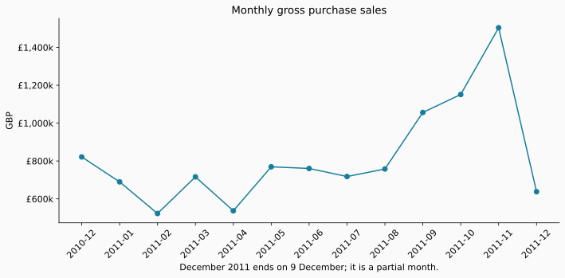
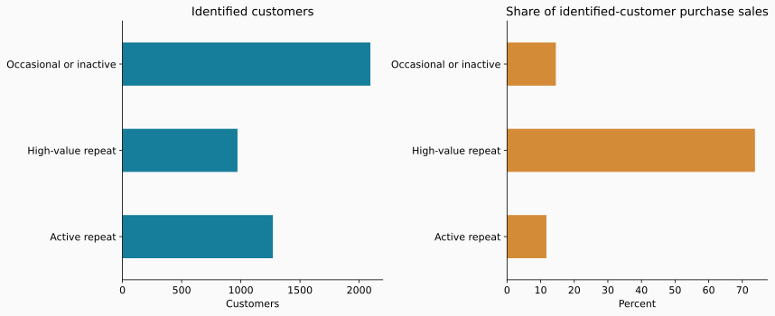
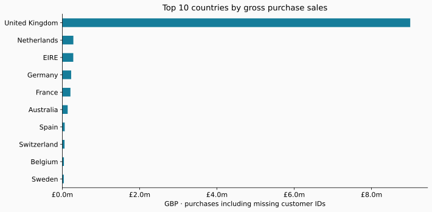

# Customer and Market Analysis in Python

I'm **Abdul Rahman El Issa**, a Business Intelligence student. In this project, I use Python to explore purchasing patterns in public data from a UK online retailer.

I want to understand which customers return, which customer groups account for the most sales, and how sales differ across countries.

## Results

| KPI | Result |
| --- | ---: |
| Gross purchase sales | £10,642,110.80 |
| Purchase orders | 19,960 |
| Identified purchasing customers | 4,338 |
| Average purchase order value | £533.17 |
| Repeat customer rate | 65.58% |

After the documented exclusions, 524,878 purchase lines remain. Of these, 132,186 have no customer ID and contribute to sales totals but cannot be assigned a customer segment.

The high-value repeat group contains 972 customers, or 22.41% of identified purchasing customers, and accounts for 73.77% of their purchase sales. This concentration suggests that understanding the needs of these customers could be useful, but spending alone does not establish profitability. The other groups contain 1,271 active repeat customers and 2,095 occasional or inactive customers.

A practical next step would be to investigate service needs among high-value repeat customers and separate occasional customers from inactive repeat buyers before testing different messages. These are proposed actions; this analysis does not measure any campaign effect.

## Data

The [UCI Online Retail dataset](https://archive.ics.uci.edu/dataset/352/online+retail) contains 541,909 product lines from 1 December 2010 to 9 December 2011. A row is an invoice line, rather than a whole order or a unique customer. Prices are in GBP. The retailer sells gifts and has wholesale customers, so large orders can influence the results.

Source: Chen, D. (2015). *Online Retail* [Dataset]. UCI Machine Learning Repository. [DOI](https://doi.org/10.24432/C5BW33). Data licensed under [CC BY 4.0](https://creativecommons.org/licenses/by/4.0/). This project transforms and summarizes the original data.

## Five KPIs

| Measure | Definition |
| --- | --- |
| Gross purchase sales | Sum of quantity × unit price on retained positive purchase lines |
| Purchase orders | Distinct invoice numbers on retained purchase lines |
| Identified purchasing customers | Distinct non-missing customer IDs on retained purchase lines |
| Average purchase order value | Gross purchase sales divided by purchase orders |
| Repeat customer rate | Identified customers with at least two purchase invoices divided by all identified purchasing customers |

Sales and order totals include purchases without customer IDs. Customer measures and segments use only identified customers. Gross purchase sales exclude cancellations and returns; they are not net revenue, profit, or customer lifetime value.

## Three customer segments

I calculate recency (days since the last purchase), frequency (distinct purchase invoices), and monetary value (purchase spending). The reference date is the day after the final source date.

The groups are assigned in this order:

1. **High-value repeat:** purchased within 90 days, at least two orders, and spending at or above the identified-customer 75th percentile.
2. **Active repeat:** purchased within 90 days and at least two orders, excluding the high-value group.
3. **Occasional or inactive:** all other identified purchasing customers.

These are business rules chosen for this project, not machine-learning clusters or a proven optimal targeting strategy. The last group combines different behaviors and would need further investigation before a campaign. No demographic attributes are available.

## Cleaning decisions

- Remove exact repeated lines as a documented assumption. Without a line ID, legitimate identical lines cannot be ruled out. A no-deduplication sales total is included in the quality report for comparison.
- Exclude invoice numbers starting with C, then non-positive quantities and non-positive prices. The sequential audit records each removal once.
- Retain missing customer IDs for sales analysis; exclude them from customer segmentation without inventing IDs.
- Retain positive invoiced charges and unusual large purchases. The source does not support reliably identifying all product versus service charges.
- Preserve fractional-penny source prices by calculating totals in integer millionths of a pound. Display final currency amounts to two decimal places.
- Treat December 2011 as a partial month. Country sales describe this retailer's customers, not national market size or market share.

## Run the project

Requires Python 3.10 or later. In this folder:

```bash
python3 -m venv .venv
source .venv/bin/activate
python -m pip install -r requirements.txt
python src/analyze.py --download
python src/verify.py
```

The first run downloads the original UCI archive. Later runs can use `python src/analyze.py` with the saved data. Raw downloads and customer-level output stay in the ignored `data/raw/` folder.

`requirements-lock.txt` records the exact package versions used for the initial run.

The script writes KPI and data-quality JSON reports, a cleaning audit, segment/country/month summaries, and three charts. It checks that exclusions reconcile to the source count, sales reconcile across orders/months/countries, and segments reconcile to identified customers and their sales.

`src/verify.py` reads the source independently with openpyxl and Decimal arithmetic. All five KPIs and the original and retained row counts matched on the completed run; see `results/independent_verification.json`.

## Charts







## Files

- `src/analyze.py`: download, cleaning, analysis, checks and charts.
- `src/verify.py`: independent calculation of the five KPIs.
- `results/`: calculated summaries and data-quality evidence.
- `charts/`: figures generated by the script.
- `requirements.txt`: Python packages needed to run the project.

This is a student portfolio analysis of historical public data. Recommendations would need testing before use in a real business.
